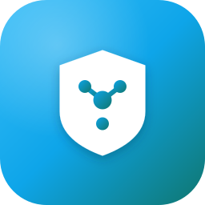

<p align="center">
  
</p>

# VPN Admin (vpn-admin)

[Русская версия](README_ru.md)

**VPN Admin** is a visual control plane for VPN services. It manages servers, users, provider resources and network links
without tying the core application to a specific VPN protocol. AmneziaWG and WireGuard are supported through the AWG
provider; additional providers can implement the same resource and manifest API.

A single instance can manage multiple servers. The local database is the source of truth, while agents reconcile desired
provider resources and links on managed hosts.

> **Installation, configuration, migration and the full guide:** [docs/GUIDE.md](docs/GUIDE.md)

## Overview

The main workspace combines a server map, tunnel editor, user management and settings. Servers can be grouped by location
on the map, while provider interfaces are connected into explicit network topologies in the tunnel editor.

Providers describe their resources with JSON schemas. VPN Admin uses those schemas to generate management forms with RJSF,
instead of hard-coding every provider's configuration model. Links define how compatible provider ports communicate.

The AWG provider supports interface and peer resources, AmneziaWG obfuscation, client configurations and QR codes, metrics,
and kernel or userspace operation. Agent and provider failures are exposed as resource conditions rather than silently
removing desired state.

VPN Admin is available as a Wails desktop application and as a standalone web server. Both modes share the same data model,
business logic and frontend.

## Architecture

### Admin app

The administrative application stores infrastructure metadata, manages servers and users, renders provider-defined forms,
and coordinates resource and link reconciliation through remote agents.

The root Go module contains the application, API, BoltDB storage and pack definitions. The React frontend is in
`frontend/`.

### Agent and providers

`vpn-agent` is a provider-neutral HTTP service running on each managed server. It maintains desired resource state and
provider registrations, and exposes the resource API used by VPN Admin. By default it listens on loopback and is reached
through an SSH tunnel; direct mTLS connections are also supported.

The agent starts each registered provider as a child process, restarts it after an unexpected exit and stops it during
agent shutdown. Systemd therefore manages only `vpn-agent`, not separate provider units. A registration can contain the
provider command, arguments, environment, address and manifest-discovery setting.

With `discover: true`, the agent obtains resource definitions and JSON schemas from the provider's `GET /v1/manifest`
endpoint. Static registrations can embed definitions instead.

The unified `vpn-provider-awg` manages AmneziaWG and WireGuard interfaces. It selects the kernel backend when
`modinfo amneziawg` or `modinfo wireguard` succeeds and otherwise uses `amneziawg-go`. The `--userspace` flag or
`VPN_PROVIDER_AWG_USERSPACE=true` forces userspace mode.

Agent and providers use the Go module path `github.com/ks-tool/vpn-agent`. Their sources and independent release workflow
are being prepared in `agent/` for the separate `github.com/ks-tool/vpn-agent` repository.

### Configuration and releases

All non-admin binaries use `github.com/ks-tool/app-config/go`. Environment variables provide configuration and equivalent
command-line flags override them. Each binary documents its options through `--help`.

Each component tag builds only that component and publishes a multi-architecture OCI artifact through `oci-packer`:

- `agent/v1.2.3` → `ghcr.io/ks-tool/vpn-agent:v1.2.3`;
- `providers/awg/v1.2.3` → `ghcr.io/ks-tool/vpn-providers/awg:v1.2.3`.

Installation is performed through `pack` with an OCI-capable target; ansible-target is not used. See
[pack/README.md](pack/README.md).

### Data storage

Administrative metadata is stored in BoltDB at `~/.vpn-admin/db`. This includes servers, SSH credentials, users, provider
resources, interfaces and links. Other application data is kept under `~/.vpn-admin/`: ACME cache, plugins and download
cache.

The agent stores desired provider state and registrations in its own state directory. Each provider keeps protocol-specific
runtime state separately; AWG stores interface keys, peers and metrics history under `VPN_PROVIDER_AWG_DB`.

The v1-to-v2 migration is manual and reads the v1 database without modifying it. See
[docs/migrate_v2.md](docs/migrate_v2.md).

## Building from source

Requirements: Go **1.27.1** or later and Node.js **24** or later.

```sh
make server       # standalone web server
make run-server   # local development server through go run
make desktop      # Wails desktop application
make agent        # provider-neutral Linux agent
make provider-awg # unified Linux AWG provider
make migrate      # awg-migrate utility
make test         # unit tests for both Go modules
```

Build artifacts are written to `build/bin/`. Targets that include the UI build the frontend automatically. The desktop
build uses the Wails CLI through `go tool wails`.

The Docker-based AWG userspace tunnel test is separate and requires Docker with `/dev/net/tun` and `NET_ADMIN`:

```sh
make -C agent test-e2e
```

## License

This project is licensed under the Apache License 2.0. See [LICENSE](LICENSE) for the full license text.
