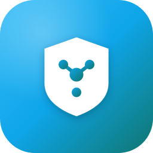

<p align="center">
  
</p>

# VPN Admin (vpn-admin)

[English version](README.md)

**VPN Admin** — визуальная панель управления VPN-сервисами. Она управляет серверами, пользователями, ресурсами провайдеров и
сетевыми связями, не привязывая ядро приложения к конкретному VPN-протоколу. AmneziaWG и WireGuard поддерживаются через
AWG-провайдер; другие провайдеры могут реализовать тот же API ресурсов и manifest.

Один экземпляр управляет несколькими серверами. Локальная база данных является источником истины, а агенты приводят ресурсы
провайдеров и сетевые связи на управляемых хостах к желаемому состоянию.

> **Установка, настройка, миграция и полное руководство:** [docs/GUIDE_ru.md](docs/GUIDE_ru.md)

## Обзор

Основное рабочее пространство объединяет карту серверов, редактор туннелей, управление пользователями и настройки. Серверы
группируются по географическому расположению на карте, а интерфейсы провайдеров соединяются в явные сетевые топологии в
редакторе туннелей.

Провайдеры описывают ресурсы JSON-схемами. VPN Admin строит по ним формы управления через RJSF, а не задаёт модель
конфигурации каждого провайдера в собственном коде. Связи определяют взаимодействие совместимых портов провайдеров.

AWG-провайдер поддерживает ресурсы интерфейсов и пиров, обфускацию AmneziaWG, клиентские конфигурации и QR-коды, метрики,
kernel- и userspace-режимы. Сбои агента и провайдера отображаются как условия состояния ресурсов и не приводят к неявному
удалению желаемой конфигурации.

VPN Admin доступен как desktop-приложение на Wails и как standalone веб-сервер. Оба режима используют общую модель данных,
бизнес-логику и frontend.

## Архитектура

### Admin app

Административное приложение хранит метаданные инфраструктуры, управляет серверами и пользователями, строит формы по схемам
провайдеров и координирует согласование ресурсов и связей через удалённых агентов.

Корневой Go-модуль содержит приложение, API, BoltDB-хранилище и pack-описания. React-frontend находится в `frontend/`.

### Агент и провайдеры

`vpn-agent` — нейтральный к VPN-протоколам HTTP-сервис на каждом управляемом сервере. Он хранит желаемое состояние ресурсов
и регистрации провайдеров и предоставляет resource API для VPN Admin. По умолчанию агент слушает loopback и доступен через
SSH-туннель; также поддерживается прямое подключение по mTLS.

Агент запускает каждый зарегистрированный провайдер как дочерний процесс, перезапускает его после неожиданного завершения и
останавливает при своём shutdown. Поэтому systemd управляет только `vpn-agent`, отдельные unit-файлы провайдеров не нужны.
Регистрация может содержать команду, аргументы, environment, адрес и настройку manifest discovery.

При `discover: true` агент получает определения ресурсов и JSON-схемы через `GET /v1/manifest` провайдера. Статические
регистрации могут содержать определения непосредственно.

Единый `vpn-provider-awg` управляет интерфейсами AmneziaWG и WireGuard. Он выбирает kernel-бэкенд при успешном
`modinfo amneziawg` или `modinfo wireguard`, а иначе использует `amneziawg-go`. Флаг `--userspace` или
`VPN_PROVIDER_AWG_USERSPACE=true` принудительно включает userspace-режим.

Агент и провайдеры используют Go module path `github.com/ks-tool/vpn-agent`. Их исходный код и независимый release workflow
готовятся в `agent/` к переносу в отдельный репозиторий `github.com/ks-tool/vpn-agent`.

### Конфигурация и релизы

Все бинарники, кроме админки, используют `github.com/ks-tool/app-config/go`. Настройки задаются через environment и
переопределяются соответствующими аргументами командной строки. Полный список параметров каждый бинарник показывает по
`--help`.

Каждый тег собирает только свой компонент и публикует через `oci-packer` мультиархитектурный OCI-артефакт:

- `agent/v1.2.3` → `ghcr.io/ks-tool/vpn-agent:v1.2.3`;
- `providers/awg/v1.2.3` → `ghcr.io/ks-tool/vpn-providers/awg:v1.2.3`.

Установка выполняется через `pack` с target, поддерживающим OCI; ansible-target не используется. Подробности приведены в
[pack/README.md](pack/README.md).

### Хранение данных

Метаданные административного приложения хранятся в BoltDB `~/.vpn-admin/db`: серверы, SSH-учётные данные, пользователи,
ресурсы провайдеров, интерфейсы и связи. Остальные данные приложения находятся в `~/.vpn-admin/`: ACME-кэш, плагины и кэш
загрузок.

Агент хранит желаемое состояние и регистрации провайдеров в собственном каталоге. Каждый провайдер отдельно хранит
протокол-специфичное рабочее состояние; AWG использует `VPN_PROVIDER_AWG_DB` для ключей интерфейсов, пиров и истории метрик.

Миграция с v1 на v2 выполняется вручную и не изменяет исходную базу v1. Процесс описан в
[docs/migrate_v2.md](docs/migrate_v2.md).

## Сборка из исходного кода

Требуются Go **1.27.1** или новее и Node.js **24** или новее.

```sh
make server       # standalone веб-сервер
make run-server   # локальный запуск через go run
make desktop      # desktop-приложение на Wails
make agent        # нейтральный Linux-агент
make provider-awg # единый Linux AWG-провайдер
make migrate      # утилита awg-migrate
make test         # unit-тесты обоих Go-модулей
```

Артефакты сборки помещаются в `build/bin/`. Цели, использующие UI, автоматически собирают frontend. Для desktop-сборки Wails
CLI вызывается через `go tool wails`.

Docker-тест реального AWG userspace-туннеля запускается отдельно и требует Docker с `/dev/net/tun` и `NET_ADMIN`:

```sh
make -C agent test-e2e
```

## Лицензия

Проект распространяется по лицензии Apache License 2.0. Полный текст лицензии приведён в файле [LICENSE](LICENSE).
